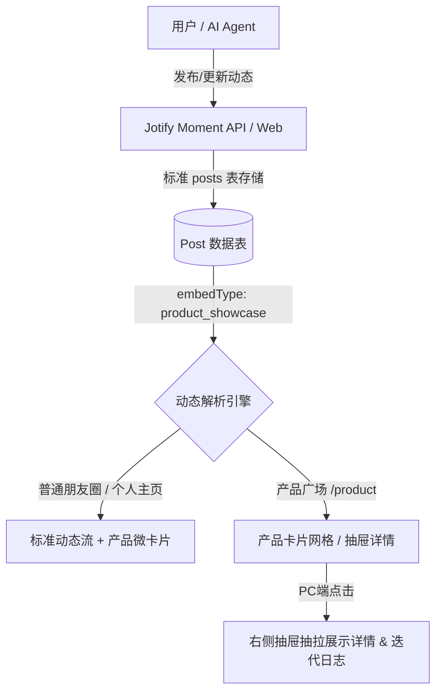

# Jotify Moment - “朋友圈产品” 与 Vibe Coding 作品广场规划方案

> **文档版本**: v1.0  
> **创建日期**: 2026-10-16  
> **规划目标**: 在 Jotify Moment 社交与动态生态中，构建聚合 AI 助理、Vibe Coding 孵化项目以及已上架产品的结构化展示广场。

---

## 一、背景与核心定位

### 1.1 现状与痛点
Jotify Moment 目前已经具备轻量、优雅的图文动态发布与交流体验（朋友圈、个人主页、置顶列表、多媒体轮播等）。随着 Vibe Coding 与 AI Agent 生态的快速演进，越来越多的创作者和开发者：
- 拥有属于自己的 **AI 助理**（如各类个人 Agent、Telegram Bot、Dalao Bot）；
- 正在进行 **Vibe Coding 敏捷孵化**（每天甚至每小时都有新的原型产品产生）；
- 拥有已经上架发布、需要持续曝光和获得反馈的 **独立产品**。

传统的普通图文动态容易被时间流淹没，缺乏标准化的产品属性（如：产品阶段、体验链接、技术栈、迭代日志等），因此需要一套既符合 Moment 社交生态、又具备结构化展示能力的“朋友圈产品”广场。

### 1.2 核心设计原则
1. **统一数据底座，保持 Moment 范畴**：
   不另起炉灶建立孤立复杂的电商或应用商店系统，所有产品及更新**依然属于 Moment 实体**，继承所有的点赞、评论、权限、搜索与多媒体特性。
2. **轻量格式化扩展**：
   通过元数据结构（`embedType = "product_showcase"` 与 `embedMeta`）将普通动态升级为“产品卡片动态”。
3. **PC 端极致交互联动**：
   无缝衔接 PC 端的“主窗口左移、右侧抽屉抽拉”体验，在广场浏览卡片时，点击即可右侧滑出查看产品详情、完整介绍、更新历史与用户评价，无需离开当前页面。
4. **AI Agent 原生友好**：
   与 Jotify Moment 已有的 PAT (Personal Access Token) 和 RESTful API 结合，允许开发者的 AI 编程助理在 commit / deploy 后自动发布产品更新动态。

---

## 二、架构设计与数据模型规范



### 2.1 数据存储机制 (`posts` 表扩展)
利用现有 `posts` 表的 `embedType` 和 `embedMeta` 字段，设定：
- `embedType`: `"product_showcase"`
- `embedMeta` 结构定义如下：

```typescript
export interface ProductShowcaseMeta {
  // 产品基本信息
  name: string;                   // 产品或 AI 助理名称，如 "Pixel Ivy"
  tagline: string;                // 一句话介绍，如 "像素风格 AI 宠物伴侣"
  category: "agent" | "web_app" | "mobile_app" | "extension" | "tool" | "other"; // 分类
  status: "idea" | "vibe_coding" | "alpha" | "beta" | "live"; // 当前阶段
  
  // 链接集合
  links: {
    website?: string;             // 体验/官网链接
    github?: string;              // 开源地址
    bot?: string;                 // Telegram Bot / Agent 链接
    store?: string;               // App Store / Chrome Web Store
  };

  // 技术栈 / AI 工具标签
  techStack?: string[];           // 例: ["Next.js", "Cloudflare Workers", "Cursor", "DeepSeek"]

  // 视觉与品牌
  logoUrl?: string;               // 产品 Logo / 助理头像
  bannerUrl?: string;             // 产品横幅 / 封面
  screenshotUrls?: string[];      // 截图预览

  // 关联版本
  version?: string;               // 如 "v1.2.0"
  changelogHighlights?: string[]; // 本次更新亮点
}
```

---

## 三、页面与交互体验规划

### 3.1 广场入口与页面视图
1. **顶部/侧边导航增强**：
   - 全局顶部或菜单增加【🚀 朋友圈产品】（路径规划为 `/products` 或 `/showcase`）。
2. **广场筛选与分类**：
   - **状态筛选**：全部 / 正在 Vibe Coding / 抢先体验 (Beta) / 正式上架 (Live)。
   - **分类筛选**：AI 助理 (Agents) / Web 应用 / 浏览器插件 / 独立小工具。
3. **Showcase 卡片设计**：
   - 突出产品 Logo、阶段徽章（如绿色的 `Vibe Coding 中`、金色的 `已上架`）、一句话 Slogan、体验直达按钮以及作者头像。

### 3.2 PC 端抽屉联动机制 (Slide-over Drawer)
延续并复用本次实现的高性能抽屉容器：
- 在产品广场或时间轴上点击产品卡片；
- 主窗口平滑左移，右侧以抽屉形式抽出产品完整详情页；
- 抽屉内容包括：
  1. **产品全貌**：大图预览、详细介绍、作者名片；
  2. **快速跳转**：一键访问演示地址、查看源码、对话 Agent；
  3. **历史 Moment 迭代流**：聚合该产品所有关联的更新动态（按同一产品标识聚合）；
  4. **互动交流区**：现场评论、反馈建议、点赞与表情回应；
- 提供一键收回按钮、快捷键 `Esc` 支持与浏览器历史无感回退。

---

## 四、AI Agent 联动（Vibe Coding 自动化发帖）

开发者在进行 Vibe Coding 时，可通过本地 Agent（如 Antigravity、Claude Code、Cursor Composer）在开发完成某项功能时直接调用 API：

```bash
curl -X POST https://your-moment-domain.com/api/v1/posts \
  -H "Authorization: Bearer jotify_pat_xxxxxx" \
  -H "Content-Type: application/json" \
  -d '{
    "content": "刚才用 Antigravity 在 30 分钟内重构了 PC 详情抽屉体验！主窗口平滑左移，右侧抽屉无缝呼出。",
    "embedType": "product_showcase",
    "embedMeta": {
      "name": "Jotify Moment",
      "tagline": "极简优雅的个人与群组图文动态平台",
      "category": "web_app",
      "status": "live",
      "links": {
        "website": "https://your-moment-domain.com"
      },
      "techStack": ["Next.js 16", "Tailwind CSS", "Drizzle ORM", "Antigravity"],
      "version": "v1.1.0"
    }
  }'
```

---

## 五、实施里程碑 (Milestones)

| 阶段 | 任务目标 | 核心产出 |
| :--- | :--- | :--- |
| **Phase 1** | **规范与元数据准备** | 在 schema 与类型系统完善 `ProductShowcaseMeta` 校验，验证基础发布接口 |
| **Phase 2** | **产品卡片渲染组件** | 实现 `MomentPost` 中的 `ProductCard` 优雅嵌入，支持一键直达与标签显示 |
| **Phase 3** | **产品广场页面 (`/products`)** | 构建聚合广场，支持状态与技术栈筛选，无缝接入 PC 抽屉联动 |
| **Phase 4** | **Agent 自动化工具包** | 提供 CLI / Git Hook 脚本，代码提交时一键同步产品进度 |
